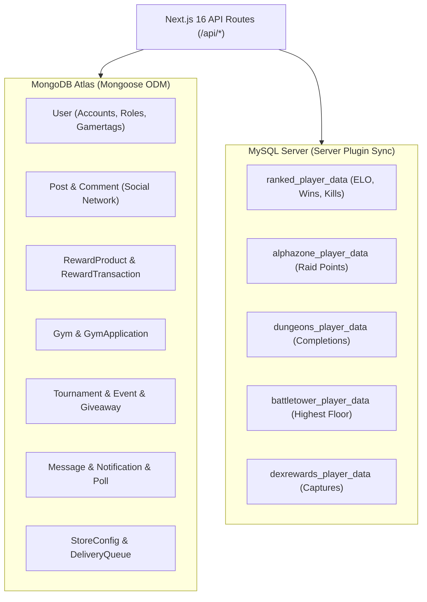

# POKEFUN — ARCHITECTURE & DATABASE SPECIFICATION

---

## 1. Dual-Database Architecture Overview

POKEFUN uses a specialized dual-database setup designed to bridge modern Next.js web application persistence with real-time in-game Minecraft server plugins:

---

## 2. MongoDB Schema Directory (17 Mongoose Models)

### 2.1 User (`src/models/User.ts`)
- **Fields:**
  - `name`: String, required.
  - `email`: String, required, unique, indexed.
  - `image`: String (Discord / Google avatar URL).
  - `role`: Enum (`'user' | 'vip' | 'mod' | 'admin'`), default `'user'`.
  - `bio`: String, max 300 chars.
  - `points`: Number, default 0 (Rewards economy balance).
  - `streak`: Number, default 0 (Daily check-in streak).
  - `lastCheckIn`: Date (Timestamp of last daily reward claim).
  - `connections`: Object `{ minecraft?: string, discord?: string, xbox?: string }`.
  - `followers`: Array of `ObjectId` ref `User`.
  - `following`: Array of `ObjectId` ref `User`.
  - `badges`: Array of Strings (e.g. `'BETA_TESTER'`, `'GYM_LEADER'`, `'STAFF'`).
  - `isBanned`: Boolean, default `false`.
  - `banReason`: String.
  - `warnings`: Array of `{ reason: string, issuedBy: string, date: Date }`.
- **Timestamps:** Automatic `createdAt`, `updatedAt`.

### 2.2 Post (`src/models/Post.ts`)
- **Fields:**
  - `author`: `ObjectId` ref `User`, required, indexed.
  - `content`: String, required, max 3000 chars.
  - `media`: Array of `{ url: string, type: 'image' | 'video' }`.
  - `tags`: Array of Strings (`['showcase', 'trade', 'question']`).
  - `likes`: Array of `ObjectId` ref `User`.
  - `favoriteCount`: Number, default 0.
  - `isPinned`: Boolean, default `false`.
  - `isReel`: Boolean, default `false`.
  - `reelViews`: Number, default 0.
- **Timestamps:** Automatic `createdAt`, `updatedAt`.

### 2.3 Comment (`src/models/Comment.ts`)
- **Fields:**
  - `postId`: `ObjectId` ref `Post`, required, indexed.
  - `author`: `ObjectId` ref `User`, required.
  - `content`: String, required.
  - `parentCommentId`: `ObjectId` ref `Comment` (for nested threaded replies).
  - `likes`: Array of `ObjectId` ref `User`.

### 2.4 Gym & GymApplication (`src/models/Gym.ts`, `src/models/GymApplication.ts`)
- **Gym Fields:**
  - `name`: String (`'Fire Gym'`, `'Dark Gym'`, etc.).
  - `type`: String (`'Fire'`, `'Water'`, `'Grass'`, `'Dark'`, `'Electric'`, etc.).
  - `badgeName`: String (`'Volcano Badge'`, `'Eclipse Badge'`).
  - `badgeIcon`: String (Path to asset).
  - `leaderId`: `ObjectId` ref `User`.
  - `leaderGamertag`: String.
  - `isOpen`: Boolean, default `true`.
  - `rules`: Array of Strings.
- **GymApplication Fields:**
  - `userId`: `ObjectId` ref `User`, required.
  - `gamertag`: String, required.
  - `gymType`: String, required.
  - `teamProofUrl`: String.
  - `status`: Enum (`'pending' | 'approved' | 'rejected'`).
  - `reviewedBy`: `ObjectId` ref `User`.
  - `reviewNotes`: String.

### 2.5 Tournament & Event & Giveaway (`src/models/Tournament.ts`, `src/models/Event.ts`, `src/models/Giveaway.ts`)
- **Tournament:** `title`, `format` (Singles 6v6, Doubles, Monotype), `bracketData` (JSON tree), `maxParticipants`, `participants` (Array of user refs), `prizes`, `status` (`'upcoming' | 'live' | 'finished'`).
- **Event:** `title`, `description`, `bannerUrl`, `startTime`, `endTime`, `type` (`'raid_hour' | 'double_xp' | 'tournament'`).
- **Giveaway:** `title`, `itemDescription`, `itemImageUrl`, `winnerCount`, `entries` (Array of user refs), `winners` (Array of user refs), `endsAt`, `isResolved`.

### 2.6 Rewards Engine (`src/models/RewardProduct.ts`, `src/models/RewardTransaction.ts`)
- **RewardProduct:** `title`, `costPoints`, `category` (`'crate_keys' | 'ranks' | 'cosmetics'`), `commandToRun` (e.g. `/crates give %player% master 1`), `inStock`, `imageUrl`.
- **RewardTransaction:** `userId` ref `User`, `amount`: Number, `type` (`'earn' | 'spend' | 'daily_claim' | 'admin_adjust'`), `description`: String, `metadata`: Object.

### 2.7 Tebex Store & In-Game Deliveries (`src/models/StoreConfig.ts`, `src/models/DeliveryQueue.ts`)
- **StoreConfig:** `activeSale`: Boolean, `discountPercentage`: Number (e.g. 15), `saleTitle`: String, `saleSubtitle`: String, `saleEndDate`: Date.
- **DeliveryQueue:** `transactionId`: String, `username`: String (Minecraft Gamertag), `packages`: Array of package IDs, `commands`: Array of command strings, `status` (`'pending' | 'delivered' | 'failed'`), `retryCount`: Number.

### 2.8 Direct Messaging & Web Push (`src/models/Message.ts`, `src/models/Notification.ts`, `src/models/Poll.ts`, `src/models/GlobalConfig.ts`)
- **Message:** Direct player-to-player threads with `senderId`, `receiverId`, `content`, `readStatus`, `timestamp`.
- **Notification:** User in-app notifications for replies, likes, gym challenge alerts, system announcements.
- **Poll:** Multiple choice voting polls with options array `{ text: string, votes: ObjectId[] }`.

---

## 3. MySQL Server Database Schema (Minecraft Plugin Sync)

Connected via `src/lib/mysql.ts` connection pool (limit 40). Queries the live MySQL instance populated by Cobblemon SMP plugins:

| Table Name | Primary Columns | Purpose |
|---|---|---|
| `ranked_player_data` | `uuid`, `name`, `elo`, `wins`, `losses`, `kills` | Competitive PvP Ranked ladder rankings |
| `alphazone_player_data` | `uuid`, `player_name`, `elo`, `points`, `raids_won` | High-tier Alpha Zone raid leaderboard |
| `dungeons_player_data` | `uuid`, `player_name`, `dungeons_completed`, `deaths` | Procedural dungeon progression metrics |
| `battletower_player_data` | `uuid`, `player_name`, `highest_floor`, `tokens` | Battle Tower floor challenge records |
| `dexrewards_player_data` | `uuid`, `player_name`, `captures`, `dex_progress` | Cobblemon Pokédex catch milestones |

The `/api/leaderboard` endpoint dynamically joins MySQL game data with MongoDB `User` documents to display player avatars and website profiles alongside in-game rankings.

---

## 4. Complete REST API Route Directory (69 Endpoints)

### 4.1 Admin APIs (`/api/admin/*`)
- `POST /api/admin/actions/ban`: Ban or unban a player profile.
- `POST /api/admin/actions/warn`: Issue official disciplinary warnings.
- `GET /api/admin/actions/users`: Audit query user account histories.
- `POST /api/admin/actions/clear-posts`: Mass delete spam or offensive feed content.
- `GET, POST, DELETE /api/admin/giveaways`: Manage giveaway countdowns and roll winners.
- `GET, POST /api/admin/messages`: System broadcast direct messages to player inboxes.
- `GET, PUT, DELETE /api/admin/posts`: Moderate community posts and pin announcements.
- `GET, PUT /api/admin/store-config`: Manage store banner title, discount %, and timer.
- `GET /api/admin/system-config`: Global server statistics and metrics audit.
- `GET, PUT /api/admin/users`: Update user roles (`admin`, `mod`, `vip`), verify Gamertags.

### 4.2 Authentication & User Profiles (`/api/auth/*`, `/api/user/*`, `/api/profile/*`)
- `ALL /api/auth/[...nextauth]`: OAuth callback handling for Discord and Google providers.
- `GET /api/user/active`: Live online user heartbeat count.
- `POST /api/user/follow`: Follow or unfollow another user profile.
- `GET, PUT /api/profile`: Fetch or update authenticated user profile data.
- `GET /api/profile/[id]`: Retrieve public profile by user ID or Minecraft gamertag.
- `GET /api/profile/[id]/follow`: Query follower and following lists.
- `GET /api/profile/[id]/network`: Graph query of player social connections.
- `GET, POST /api/profile/connections`: Link or unlink Minecraft gamertag and Discord handle.
- `GET /api/users`: Search user directory with autocomplete.
- `POST /api/verify`: Authenticate Minecraft gamertag ownership via in-game code.

### 4.3 Community & Social APIs (`/api/community/*`, `/api/polls/*`, `/api/reels/*`)
- `GET, POST /api/community`: Feed list retrieval with pagination and new post submission.
- `GET, PUT, DELETE /api/community/[id]`: Single post details, editing, and deletion.
- `GET, POST /api/community/[id]/comments`: Threaded comment list and new reply creation.
- `POST /api/community/[id]/comments/[commentId]/interact`: Like or flag individual comments.
- `POST /api/community/[id]/favorite`: Bookmark post to user profile favorites.
- `POST /api/community/[id]/interact`: Like, unlike, and engagement increment.
- `GET /api/community/[id]/stats`: View counts, unique reach, and share metrics.
- `POST /api/community/like`: Quick like toggle.
- `GET, POST /api/reels`: Video feed fetch and video reel upload metadata.
- `GET, POST /api/polls`: Query active polls and submit new community questions.
- `POST /api/polls/vote`: Submit authenticated vote on poll options.
- `GET, POST /api/studio`: Video analytics for content creators.

### 4.4 In-Game Sync & Competitive APIs (`/api/gyms/*`, `/api/tournaments/*`, `/api/events/*`, `/api/leaderboard/*`)
- `GET /api/gyms`: List all 18 Gym Leaders, current status, and online presence.
- `GET /api/gyms/applications`: Admin list of pending Gym Leader applications.
- `POST /api/gyms/apply`: Submit player application for a Gym Leader slot.
- `POST /api/gyms/challenge`: Enqueue player in gym challenge queue.
- `POST /api/gyms/revoke`: Admin endpoint to strip inactive Gym Leader badge.
- `GET /api/gyms/rules`: Official gym battle rules and level tier constraints.
- `GET /api/leaderboard`: Query live MySQL leaderboards (Ranked, Dungeons, Raids, Dex).
- `GET, POST /api/tournaments`: List tournament brackets and register player.
- `GET, POST /api/events`: Calendar schedule of server events.
- `GET, POST /api/giveaways`: List giveaways and join entries.
- `POST /api/giveaways/join`: Authenticated user giveaway entry.

### 4.5 Rewards & BitLabs APIs (`/api/rewards/*`)
- `GET, POST /api/rewards/daily-checkin`: Claim 24-hour streak rewards with multiplier.
- `GET /api/rewards/history`: Paginated ledger of point transactions.
- `GET /api/rewards/products`: Catalog of redeemable reward items in Reward Shop.
- `POST /api/rewards/purchase`: Spend rewards points to redeem Minecraft items.
- `GET, PUT /api/rewards/config`: Admin configuration of daily streak reward amounts.
- `POST /api/rewards/give-points`: Admin manual points award or deduction.
- `GET /api/rewards/admin-history`: Full audit trail of economy point movements.
- `ALL /api/rewards/callbacks/bitlabs`: Secure webhook callback from BitLabs survey offerwall.

### 4.6 Direct Messaging & Notifications (`/api/messages/*`, `/api/notifications/*`)
- `GET, POST /api/messages`: Fetch conversation threads and send direct messages.
- `POST /api/messages/read`: Mark conversation messages as read.
- `GET /api/messages/unread`: Count badge polling endpoint for unread messages.
- `GET /api/notifications`: Retrieve user notification inbox.
- `POST /api/notifications/subscribe`: Register Web Push VAPID browser token.

### 4.7 Tebex Store & Deliveries (`/api/tebex/*`, `/api/delivery/*`, `/api/plugin/*`)
- `GET /api/tebex/categories`: Proxy to Tebex API for categories, packages, and prices.
- `POST /api/tebex/checkout`: Initialize Tebex checkout basket and return redirect URL.
- `GET /api/tebex/recent-payments`: Fetch latest server supporters for store feed ticker.
- `GET /api/store-config`: Public endpoint for active sale banner discounts and timers.
- `GET, POST /api/delivery`: Query or update delivery queue state.
- `ALL /api/plugin/deliveries`: Minecraft server plugin polling endpoint to execute commands.

### 4.8 Utilities & Server Health (`/api/chat`, `/api/player-count`, `/api/upload`, etc.)
- `POST /api/chat`: AI chatbot message processing via Google Gemini / Groq.
- `GET /api/player-count`: TCP query to Minecraft server `play.pokefun.in` via `minecraft-server-util`.
- `POST /api/upload`, `POST /api/upload-image`: Multi-part file upload to Google Drive storage.
- `ALL /api/webhook/discord`: Relay website events and announcements to Discord channels.
- `GET /api/heartbeat`, `GET /api/connect`: Uptime monitoring and health probes.
