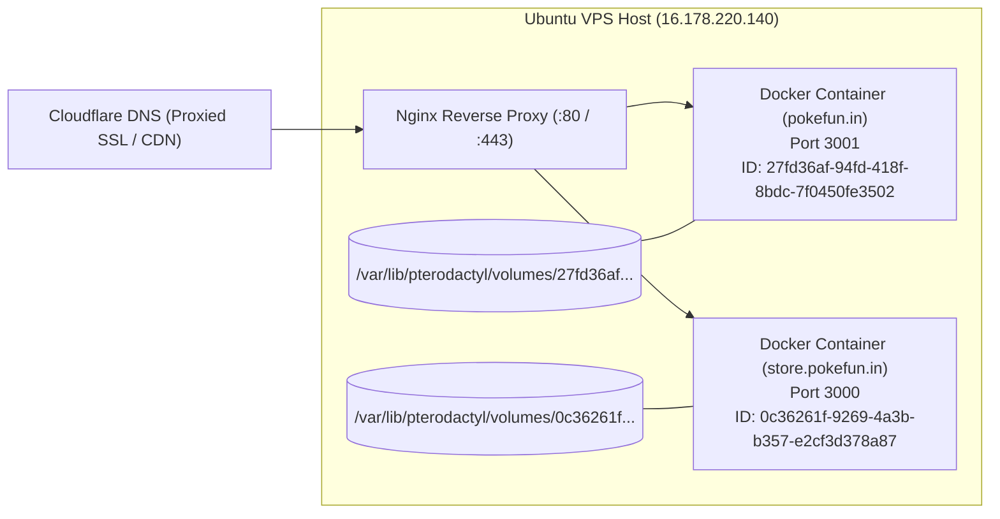

# POKEFUN — ENVIRONMENT & DEPLOYMENT SPECIFICATION

---

## 1. Production Hosting & Infrastructure Topology



### 1.1 Host Server Specifications
- **Operating System:** Ubuntu 22.04 LTS
- **Public IP:** `16.178.220.140`
- **SSH User:** `ubuntu`
- **Authentication:** RSA Private Key (`newnew1.pem`)
- **Container Management:** Pterodactyl Panel / Docker Engine
- **Web Reverse Proxy:** Nginx (`/etc/nginx/sites-available/pokefun.conf`)
- **DNS / SSL:** Cloudflare Full (Strict) SSL with edge caching

### 1.2 Container Directory Mapping

| Service | Subdomain | Internal Port | Container ID | Host Volume Mount Path |
|---|---|---|---|---|
| **Main Website** | `pokefun.in` | `3001` | `27fd36af-94fd-418f-8bdc-7f0450fe3502` | `/var/lib/pterodactyl/volumes/27fd36af-94fd-418f-8bdc-7f0450fe3502/` |
| **Store Website** | `store.pokefun.in` | `3000` | `0c36261f-9269-4a3b-b357-e2cf3d378a87` | `/var/lib/pterodactyl/volumes/0c36261f-9269-4a3b-b357-e2cf3d378a87/` |

---

## 2. Git Repositories & Synchronized Branching

| Repository | Remote URL | Branch | Local Workspace Directory |
|---|---|---|---|
| **Pokefun Main Portal** | `https://github.com/BOYSMSG/webpokefun12-06-2026.git` | `main` | `D:\Downloads\websitework\website\pokefun-nextjs-app` |
| **Pokefun Store** | `https://github.com/BOYSMSG/storeweb.git` | `main` | `D:\Downloads\websitework\website\pokefun-store` |

---

## 3. Environment Variables Reference Guide

All production environment variables are stored in `.env.local` inside the container volumes. Safe placeholders are defined in `.env.example`:

| Variable Name | Required | Purpose & Architectural Context |
|---|---|---|
| `MONGODB_URI` | Yes | MongoDB Atlas connection string. Hosts 17 collections (Users, Posts, Comments, etc.). |
| `MYSQL_HOST` | Yes | MySQL database host for in-game plugin synchronization. |
| `MYSQL_PORT` | Yes | Port for MySQL (Default: `3306`). |
| `MYSQL_DATABASE` | Yes | Database name containing ranked, dungeon, and raid tables. |
| `MYSQL_USER` | Yes | Database user credentials for queries. |
| `MYSQL_PASSWORD` | Yes | Database user password. |
| `NEXTAUTH_SECRET` | Yes | 32+ character random key used to encrypt session tokens. |
| `NEXTAUTH_URL` | Yes | Canonical application URL (`https://pokefun.in`). |
| `DISCORD_CLIENT_ID` | Yes | Discord OAuth Application Client ID for player sign-ins. |
| `DISCORD_CLIENT_SECRET` | Yes | Discord OAuth Client Secret. |
| `GOOGLE_CLIENT_ID` | Optional | Google OAuth 2.0 Client ID for Google login option. |
| `GOOGLE_CLIENT_SECRET` | Optional | Google OAuth 2.0 Client Secret. |
| `GOOGLE_DRIVE_CLIENT_EMAIL` | Yes | Google Cloud service account email for user image/reel uploads. |
| `GOOGLE_DRIVE_PRIVATE_KEY` | Yes | Service account private key string with escaped `\n` newlines. |
| `GOOGLE_DRIVE_FOLDER_ID` | Yes | Google Drive folder ID where uploaded community media is saved. |
| `GEMINI_API_KEY` | Optional | Google Gemini API key powering AIChatWidget automated responses. |
| `GROQ_API_KEY` | Optional | Groq API key for low-latency Llama-3 assistant inference. |
| `NEXT_PUBLIC_VAPID_PUBLIC_KEY` | Yes | Public VAPID key shared with browser client for Web Push alerts. |
| `VAPID_PRIVATE_KEY` | Yes | Secret VAPID key used on server to sign push notification payloads. |
| `TEBEX_PUBLIC_TOKEN` | Yes | Tebex headless webstore public account token. |
| `TEBEX_PRIVATE_KEY` | Yes | Tebex headless API secret key for basket checkout creation. |
| `TEBEX_PROJECT_ID` | Yes | Tebex headless webstore project identifier. |

---

## 4. Build & Deployment Lifecycle Commands

### 4.1 Local Development & Testing
```bash
# Navigate to main website
cd D:\Downloads\websitework\website\pokefun-nextjs-app

# Install dependencies (Node.js 18+ / 20+ required)
npm install

# Build Next.js with Turbopack optimizations
npm run build

# Start local production server on Port 3000
npm run start
```

### 4.2 Production VPS Deployment
```bash
# 1. SCP modified source files to VPS temp directory
scp -i newnew1.pem file.tsx ubuntu@16.178.220.140:/tmp/

# 2. Copy files into container volume mount
sudo cp /tmp/file.tsx /var/lib/pterodactyl/volumes/27fd36af-94fd-418f-8bdc-7f0450fe3502/src/...

# 3. Compile inside the active Docker container
sudo docker exec 27fd36af-94fd-418f-8bdc-7f0450fe3502 npm run build

# 4. Restart container to load new build output
sudo docker restart 27fd36af-94fd-418f-8bdc-7f0450fe3502

# 5. Verify live status via curl
curl -I https://pokefun.in
```
