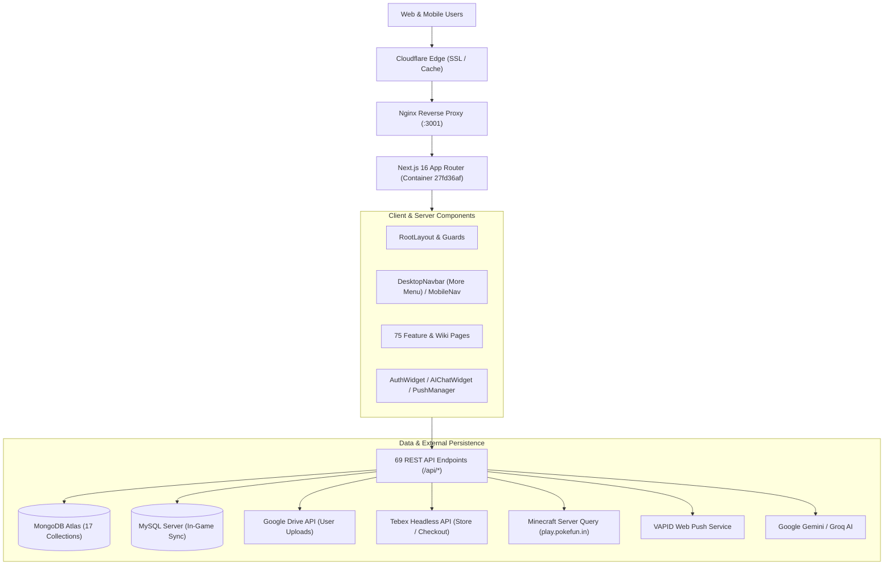

# POKEFUN — PROJECT MASTER AUDIT
**Document Version:** 1.0.0  
**Generated Date:** November 6, 2026  
**Target Reference Design:** [Shifan Portfolio](https://shifan.pokefun.in/)  
**Environment:** Next.js 16.2.9 (Turbopack) • React 19.2.4 • TypeScript 5 • Node.js  

---

## 1. Executive Summary

POKEFUN is an enterprise-grade Minecraft server community platform and web portal built specifically for the **Pokefun Cobblemon SMP (Version 1.21.1)** server, which supports both **Minecraft Java Edition** and **Minecraft Bedrock Edition**.

The platform is a multi-faceted web application that combines:
1. **Public Marketing & Information Portal:** Hero presentation, live server player counts, dynamic guidebooks, Wiki systems (Cosmetics, Fakemons, Pokémon Fusions, Pokédex), modpack downloads, rules, vote incentives, and community showcases.
2. **Community & Social Network:** Player feeds, user profile systems with Minecraft skin/avatar resolution, reels/video posting, nested comment discussions, favoriting, post liking, active user tracking, and polls.
3. **Competitive Gaming Systems:** Cobblemon Gym Leader applications, gym challenge tracking, tournament brackets, and live global leaderboards.
4. **Gamification & Rewards Engine:** Daily check-in streak rewards, task completion engine (integrated with BitLabs callbacks), reward coin economy, on-site reward shop, and transaction ledger.
5. **E-Commerce & Server Monetization:** Tebex Headless API integration for ranks, battle passes, cosmetics, and crate keys, along with real-time in-game delivery queues.
6. **Administrative Command Center:** 10 dedicated management sub-dashboards for user moderation (bans, warnings), post curation, event scheduling, giveaway coordination, gym leadership approvals, reward transaction audits, and store configuration.
7. **Omnichannel Communication & Support:** Direct player messaging, Web Push notifications via VAPID, Discord bot/webhook integration, AI support assistant widget (Google Gemini API & Groq), and real-time site announcements.

---

## 2. Technology Stack & Framework Inventory

| Layer | Technology | Version | Purpose / Architecture |
|---|---|---|---|
| **Frontend Framework** | Next.js (App Router) | `16.2.9` | Hybrid SSR, SSG, and Client-Side dynamic rendering with Turbopack |
| **Core UI Library** | React | `19.2.4` | Component tree, Server/Client component separation |
| **Styling & Theme** | CSS3 / SCSS / Tailwind CSS | `Tailwind 4`, `Sass 1.100` | Custom CSS variables, frosted glass effects, light/dark mode system |
| **Animation Libraries** | Framer Motion & Animate.css | `framer-motion 12.40.0`, `animate.css` | Micro-interactions, modal transitions, pulse badges |
| **Primary Database (Doc)** | MongoDB via Mongoose | `mongoose 9.7.0` | 17 data models for users, posts, comments, rewards, tournaments |
| **Secondary Database (SQL)** | MySQL via mysql2 | `mysql2 3.22.5` | In-game player data, economy balances, leaderboard sync |
| **Authentication** | NextAuth.js | `next-auth 4.24.14` | Session management with Discord OAuth and Google OAuth |
| **Server Health & Pings** | minecraft-server-util | `5.4.4` | Direct live UDP/TCP query of Minecraft server `play.pokefun.in` |
| **AI Assistants** | Google Generative AI & Groq | `@google/generative-ai 0.24.1` | Automated player assistant in AIChatWidget |
| **Cloud Storage** | Google Drive API | `googleapis 173.0.0` | Cloud upload storage for user screenshots, reels, and attachments |
| **Push Notifications** | Web-Push | `web-push 3.6.7` | Browser VAPID background notifications for messages and announcements |
| **E-Commerce Backend** | Tebex Headless API | REST API v2 | Package synchronization, basket creation, checkout URL redirection |

---

## 3. High-Level Architectural Flow

---

## 4. Key Subsystem Analysis

### 4.1 Authentication & User Session Lifecycle
- Authenticates users via NextAuth (`src/app/api/auth/[...nextauth]/route.ts`) supporting **Discord** and **Google** OAuth.
- Automatically creates or links a corresponding MongoDB `User` document (`src/models/User.ts`).
- Users can associate their in-game **Minecraft Java / Bedrock Gamertag**, unlocking profile personalization (skins rendered dynamically via Minotar / mc-heads CDN).
- Roles supported: `user`, `vip`, `mod`, `admin`. Admin routes enforce server-side session and role inspection.

### 4.2 Monetization & Store System
- The web portal features an embedded store client (`/store`), while simultaneously integrating with the dedicated standalone store service `store.pokefun.in`.
- Connects to Tebex Headless APIs (`/api/tebex/categories`, `/api/tebex/checkout`, `/api/tebex/recent-payments`).
- Handles multi-server currency conversions (USD, INR, EUR, GBP, AUD, CAD, etc.).
- Delivery webhook endpoint `/api/plugin/deliveries` enqueues paid perks into `DeliveryQueue` for automated RCON/plugin dispatch to the Minecraft server.

### 4.3 Community & Social Network
- **Feed & Posts (`/community`):** Users publish text, image attachments, and Pokémon showcase screenshots.
- **Reels (`/community/reels`):** Short-form video clips uploaded by the community with synchronized audio ducking.
- **Comments & Interactions:** Nested comment trees (`Comment.ts`), like counters, and favoriting.
- **Polls (`/polls`):** Server voting on upcoming events, features, and balance changes.

### 4.4 In-Game Sync (Gyms, Tournaments, Leaderboards)
- **Cobblemon Gym Leader System (`/gym_apply`, `/gym_battle`):** Players apply for Gym Leader positions (Fire, Water, Grass, Electric, Dark, etc.). Admins review applications at `/admin/gyms`.
- **Tournaments (`/tournaments`):** Bracket generation, player registration, rules, and match logs.
- **Leaderboards (`/leaderboard`):** Synchronizes top trainers by Battle Points, Gym Badges, Playtime, and Economy balances via MySQL queries.

---

## 5. Audit Conclusion & Readiness for Redesign

The existing website possesses deep, rich functionality with 75 interactive routes and 69 backend APIs. However, its historical design accumulated legacy Ghost CMS elements, inconsistent font hierarchies, and mobile responsiveness challenges.

The target vision is to elevate this entire functional suite into the aesthetic standard of **https://shifan.pokefun.in/**:
- Clean frosted-glass surfaces (`backdrop-filter: blur(16px)`).
- Electric Aqua / Ice Cyan accent glows against ultra-clean light surfaces in Light Mode.
- Deep Black (`#0B0E14`) and Slate surfaces in Dark Mode.
- Smooth CSS transitions and fluid responsiveness across every device.
- Zero changes to backend data schemas or API interfaces.
